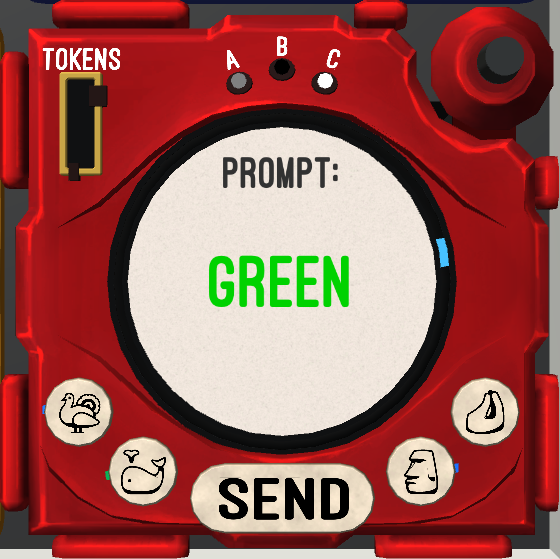

# KTANE Mods Behind-The-Scenes #27: Cruel Simulacrum

This module is pretty unsubtly my complaint about usage of AI in the KTANE Community. There are a lot of things I could say, but I'll let this small list do the talk:
- A "Simulacrum" is a fake copy without substance, taking just the appearance of something but lacking something deeper
- This is a Cruel module, there is no regular "Simulacrum", because it is always a cruel concept. I do not want a module called "Simulacrum" using the same visuals to ever exist.
- It being a Cruel module is also in reference to Cruel Murder, the module that first sparked the AI debate in the community
- It starts by giving you a "prompt"
- You must insert a "Token" before each submission to get a result
- It gives back to you Slop in the form of a shapeless blob containing bits and pieces of humanity (geometrical shapes, letters, human body)
- It shuts down after 3 stages because it has no water to cool down, not because it gave you a correct answer (the result is always slop)
- You talk to it using Turkey, Whale, Moyai and Finesse, the four alchemical basics here to represent human creation because AI could never come up with such a concept

This module recycles an idea for a "Cruel Creation" I had, which involved using Turkey Whale Moyai Finesse instead of Water Fire Earth Air as the four elements; but this is a much better usage of the idea.

The solve sound is straight-up an extract of my own song [Lonely Moon](<https://www.youtube.com/watch?v=EhOGumL15eA>) because using my own composition in a module talking against AI feels like just the correct way to go about it.

I didn't want this module just to be a protest, I wanted it to be a module that could stand on its own and be enjoyed for its solving process; so I spent a while in Photoshop just drawing grids and playing around with them until I had a process that felt interesting to use. That's how I ended up with this "movements in a triangular grid around pivots that you change".\
This is a process I enjoyed immensely and that already proved its efficiency with my next module Glass Cactus, so I'll be sure to use it again!

Editing the background casing to have the correct circular ridges to place the screen was a bit of a challenge as I'm not really experienced in using Blender, but with enough time I managed to have something that met exactly my expectations.\
I also had to customize the texture to add hand-painted highlights on the edges, otherwise the module wouldn't look correct within the artistic direction of KTANE.