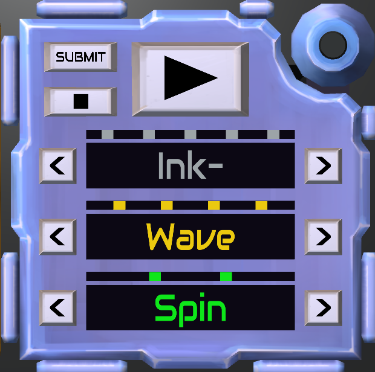

# KTANE Mods Behind-The-Scenes #26: Genre Divination

TheFatRat is an artist I like very much, and "Genius" is one of my favorite of his (I even made a Remix of it!). This is a song that has no explicit genre as said by TheFatRat himself, but he quickly accepted the proposal of one comment: "Neocortex Dash".\
That song's official music genre is "Neocortex Dash".

This immediately made me want to make a module where you listened to a randomized musical composition and determined its (fake) genre name.

Initial results included "Neocortex Dash" (which still is possible in the module), "Off-Colour Whiplash", "Cybertoxic Juice", "Lo-Liquid Craftstep", "Vibeduster Bomb" or "Flashsynk Dragon".

This is my most self-indulgent module, and probably will stay that way forever, as the music that is used in the module is all extracted from my own compositions.

I took from all of my music from the past 6+ years every possible interesting Chords, Bass, Drum and Lead tracks, transposed everything to play with the chord progression of Fm G# D# A#, did a bunch of audio balancing, and put it into the module!

Here's a list of where everything comes from, because I'm not above linking my own work. The first 5 of each instrument are in order in the manual for Rule Seed 1, the other 2 are exclusive to other Rule Seeds:

Drums:
- [Hurricane](<https://www.youtube.com/watch?v=00ZsJiLZeoE>)
- [Don't Think Now](<https://www.youtube.com/watch?v=WxZO28IuLLQ>)
- [Sepia](<https://www.youtube.com/watch?v=VOscgrUupS4>)
- [Aura](<https://www.youtube.com/watch?v=dQdSMaK9gnA>)
- [Goodbye](<https://www.youtube.com/watch?v=1UevShoS7QY>)
- [Enucleation](<https://www.youtube.com/watch?v=iXV-3YT-w-w>)
- [Scatter](<https://www.youtube.com/watch?v=Cpb9sX_CnGg>)

Bass:
- [Sepia](<https://www.youtube.com/watch?v=VOscgrUupS4>)
- [Genius](<https://www.youtube.com/watch?v=deXluJwZJCE>) (the same remix mentionned above)
- [Pipe Maze](<https://www.youtube.com/watch?v=hbORIROE-ts>)
- [Behind, Late and Worse-Off](<https://www.youtube.com/watch?v=4KJ1JFe5W9A>)
- [Mirxen - Path to the Spiller Temple](<https://www.youtube.com/watch?v=-8iaKOV3oyw>)
- [Divine Riot](<https://www.youtube.com/watch?v=trlIqfNW9lY>)
- [Heroic Riot](<https://www.youtube.com/watch?v=nFzMSListLM>)

Chords:
- [Blizzard](<https://www.youtube.com/watch?v=4MFXW02ahhQ>)
- [Genius](<https://www.youtube.com/watch?v=deXluJwZJCE>) (the same remix mentionned above)
- [Fog Emerald Moon](<https://www.youtube.com/watch?v=YIrWcQ18e-M>)
- [Moving Forward](<https://www.youtube.com/watch?v=ycfHTrST2c4>)
- [Moving Forward](<https://www.youtube.com/watch?v=ycfHTrST2c4>) again
- [Scatter](<https://www.youtube.com/watch?v=Cpb9sX_CnGg>)
- [Spirals](<https://www.youtube.com/watch?v=ExU7tOpnQCE>)

Lead:
- [Cloud Ruin](<https://www.youtube.com/watch?v=YBHcIc6vEWI>)
- [Heroic Riot](<https://www.youtube.com/watch?v=nFzMSListLM>)
- [Moving Forward](<https://www.youtube.com/watch?v=ycfHTrST2c4>)
- [Harmonies](<https://www.youtube.com/watch?v=87akIbirB38>)
- [Pipe Maze](<https://www.youtube.com/watch?v=hbORIROE-ts>)
- [Cloud Ruin](<https://www.youtube.com/watch?v=YBHcIc6vEWI>) again
- [Fog Emerald Moon](<https://www.youtube.com/watch?v=YIrWcQ18e-M>)

At first, I didn't think stopping the playback of the song was possible, but actually it was, so I added that.

Initially, I wanted the screens to be inset in the module, receeding into it, and not popping out. But I didn't feel comfortable enough doing this in modeling. Thankfully with the next module I passed a cap so I could see me still do that later down the line.

The small coloured notches above of the text on the module were added because I wanted to not need Colourblind Support for the module. Instead of just relying on the colour of the text to know which VST bank you currently have selected, you now also have the notch count that immediately tells you 1-2-3-4-5. They still are coloured to keep the link between the number and the colour.\
They move in a smooth way and I hardcoded the order in which they appear/disappear to be as pretty as possible, it's not always linear!

I wanted that module to look a bit better, so I hue-shifted the casing from blue to indigo, and that's simple but it works so well!

The solve sound for the module uses the same four chords of Fm G# D# A# in order, in my signature Glass Piano sound, which I think is a nice touch.