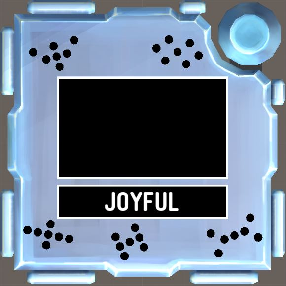

# KTANE Mods Behind-The-Scenes #3: Giants Cipher

That impossible-to-type flavour text is in reference to a [very specific meme](https://www.youtube.com/watch?v=ne73FoA8ovc) about the Regi's speech in the Pokémon Anime, and somebody graciously had a text transcript for me to use in the flavour text!\
ÜN ÜN ÜN 𓀂𓀇𓀉𓀍𓀠𓁀𓁂𓀱𓁉𓀿𓀪𓁶𓂧𓂮𓂫𓃹𓃳𓄜𓄲𓄓𓅆𓅢𓅼𓆀𓆾𓈙𓉒𓉼𓊪𓋜𓋒𓍲𓎳𓁀𓄲𓅢 ÜN ÜN ÜN ÜN ÜN ÜN AAAAAAAAAAAAAOOOOOOOOORRRRXT

This was my attempt at making a module that is 100% based on a Pokémon, down to every single individual step, while still being Good, and also much longer and complex in final scope/size.\
I'm not sure how successful it was on the "Good" part, but I think it works well enough!

The initial concept was a Cipher that didn't use words not numbers, in this case using a 5x3 grid of lights to represent the eye patterns of the 5 main Regis. One of the patterns has been encrypted and you have to find which one it was then press it.

The grid of lights was NOT inspired by Braille I think, even if Braille is heavily associated with the Regis... But it works still so that's okay!

Every individuel step is based on its specific Regi, down to (as much as possible) the edgework element used to represent them at the start of the module:
- Regirock, Cipher "R", uses Unlit Indicators as it's the most "dead" or "inorganic" edgework. Its Pokédex entry describes how "If any part chips off in battle, it attaches rocks to repair itself", so this Cipher is based on replacing part of the grid with something else. Finding the complete list of 64 words for each possible light combination was a very weird usage of Scrabble Word Finders! It originally used Braille in this step, but I couldn't come up with something good.
- Regice, Cipher "I", uses Serial Number digits because it was leftover. Its Pokédex Entry speaks about how it "cloaks itself with frigid air" and controls the air, so this Cipher step is made to emulate swirling winds surrounding the center and bringing the lights with them.
- Registeel, Cipher "S", uses Lit Indicators as it's the closest thing to binary in my opinion, with a light that turns on. This Cipher is based on binary, since it felt most appropriate for the liquid-metal Regi to have transforming numbers. I tried a few "encryption" methods that resulted in a 1-to-1 transposition of all numbers from 0 to 31, and apparently any A\*M%B where A and B are coprime work, so lucky me!
- Regieleki, Cipher "E", uses Batteries because that's electricity! The step is based on Regieleki's signature move Thunder Cage, which has an animation of electric cage raining down from above. This step also ressembles the verically mirrored logo of Regidrago since those two have a pair shenanigan going on!
- Regidrago, Cipher "D", uses Ports because it just feels right even if there's no reason. As its signature move Dragon Energy loses power the less HP it has, I made a step that becomes weaker the later it gets applied. Every sub-step is based on the animation it does when firing Dragon Energy: it rotates its arms to take on the shape of a dragon's head, charges up, fires, cools down and rotates back in place. The XOR part was made to use the inverse grid from Regieleki, bringing back their duo dynamic. It also took me like, 5 different wordings to find how to explain the "cycle" part of substeps 1 and 5, and I still don't like it.

Its Rule Seed implementation is probably my biggest so far. I'm sure I'm gonna have worse in the future (Lime Arrows looking at me right now) but still!

It also was temptatively named "Golem Cipher" since that's the fan term for this group, but I prefer to use the official one when possible.

I don't remember who said it (probably Sierra), but right after posting the module, somebody said "I can't wait until someone mistypes the module's name as Giant's Cipher instead of Giants Cipher", and it happened two days later.

I still regard this module as one of my most underrated, but it is very understandable: it's quite long, a "Cipher" which is already a loaded archetype, and isn't very flashy from the outside. However I think it still holds better than many other mods I've done since then, and I'm always happy when I read its name somewhere :D