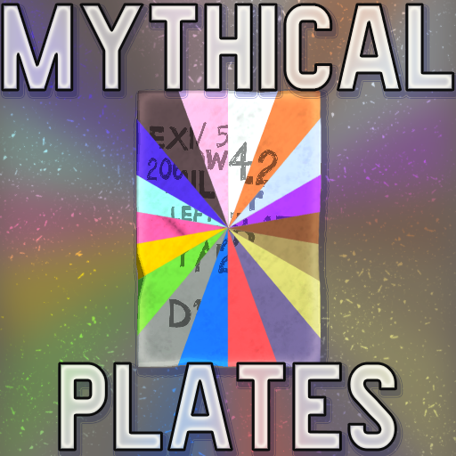
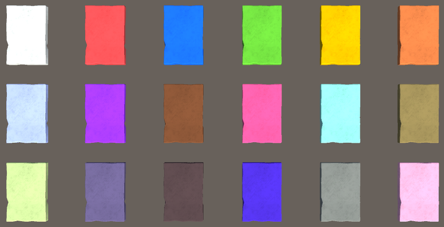

# KTANE Mods Behind-The-Scenes #7 to #25: Allmighty Sinnoh and the Mythical Plates

My biggest KTANE project ever, and will probably stay that way (on the module side!). 19 modules, all linked by the same gameplay mechanic, the same visual aspect, with one big boss (but not Boss) module summoning all of them whenever necessary.\
It was such a big project that I made a table to track my progress on all 19 modules: "Rough Concept", "Solid Idea", "Manual Writing", "Coding", "Playtesting".

This project started in December 2025 and released only in August 2026, so that's 9 months of work on this project. Still an average of two mods per month, which explains the relatively low quality of the output. I'm not really proud of it all if I'm being perfectly honest, but that's more for separate reasons that I'll explain below.

The Plates started with the easy concept of "I want to make a module based on the Pokémon Arceus". Arceus is the creator deity of the Pokémon world, able to take on any of the 18 Types thanks to its Plates.\
From the very start I knew I wanted to have a module that summoned up to 18 other modules, or at least where it could have a solving process that took parts of other modules. The main inspiration always was Ultimate Cipher. I contemplated for a while taking mechanics from my other mods: UFO Satellites being Fire-type, Relic Song being Normal-type and Toxic Crystals being Poison-type; but already the Fire was pretty weak in themeing, and it felt not that coherent.

So after a few weeks of pondering, I decided to make a modpack: 18 new modules, one for each type, all with one common mechanic, and one big module that reunited all of them.

It felt very appropriate to have them all themed around the 18 Plates of Arceus. They were going to be coloured slabs of stone, floating above the module, with markings engraved into them. Each one of them to be a reference to their assigned Type, if possible to a specific Pokémon.

As they were unmoving carved stone slabs, there was literally no way to add any feedback to the player in the sense of changing text, lights, LEDs, or anything else of the sort. This had multiple effects:
- Nothing exciting visually could happen, besides the occasional shaking, as the Plates couldn't change their writing, nor have any real animation due to having no moving parts
- Due to this, no multiple-stage modules were possible, same for many interactive ideas
- Giving feedback to the player is very limited, just sounds (Pixie and Spooky Plate) or shaking (Pixie or Stone Plate), so interactivity was very hard to do, and many modules suffered greatly from it (Pixie, Blank) although some Mind got the good end of the bargain on that one.
- No Souvenir Support is possible as the Plate always has the read visible

This results in a modpack that doesn't feel very exciting to do, they all appear same-y, and every Plate must be interesting purely using its gameplay since nothing else is available to make them interesting. So let's talk about VOID.

I needed a mechanic that was flexible enough to allow for basically any gameplay idea, but impactful enough to bring something novel even to existing concepts.

So I came up with the concept of Voided cells: Cells in grids that you phase right through. "Voided Cells do not exist" was the first concept and still is in most manuals. It was very impactful for ideas such as traversing a grid, labyrinths and other usual ideas, but it could also be applied to texts, diagrams and pretty much anything I wanted!!

Fun Fact: I learned about Rule Seed implementation while coding the Mythical Plates, because adding something new inside of that massive project didn't matter since the amount of work already was enormous! I then went back and added Rule Seed to all of my previous mods that could support it.

I spent A LOT of time tweaking the individual colours of the 18 Plates to make them as different and recognizable as possible on their own. Sure, you have their names on the casing and different inscriptions onto them... But it still mattered to me!

During those 9 months of development, there were around 4-to-5 months of pure brainstorming, just noting down ideas without coding anything; so there is a LOT of material left on the cutting room floor.

Now, it's time to go in order and talk about each individual module!

## Blank Plate - Normal Type

Blank Plate was planned from the start to be a Chess module!\
It didn't end up being one, because Void doesn't affect any piece besides pawn and knight, but that was the goal!

"Any grid-based module series MUST have a chess module. It is the law." was the initial flavour text... So guess that's illegal!\
The current flavour text is one of my favorite. It's so stupid I love it.

I then pivotted to a Platformer-type module, inspired by Subway Surfers (genuinely) so you have the three movements: move, jump, slide.

The rest just slotted in naturally: each movement has a different length, you construct your path then Void some tiles and find a correct movement sequence.

Initially, the path was much longer, you summed the indicators together to get three more characters, used the number of batteries, and even the first letter of the current mission name!\
But that was just adding tedium and unnecessary steps to something which wasn't the interesting part of the module (which is figuring out a movement sequence, not building the path), so I progressively got rid of it all.

This was my first time doing a recursive algorithm for the puzzle generation!

## Fist Plate - Fighting Type

Fist Plate initially was going to be a grid of names for people, First and Last name, and then you used that grid to get names. Nothing came out of that so it was scrapped!

It then started with the realization that there was no module based on the "Unstoppable Force vs Immovable Object" thought experiment. I came up with the "The universe will locally get destroyed and rebooted to 3,400 B.C. due to laws of physics. There will be no survivors." sentence and then immediately knew I had to make this a module.

How do you stop an Unstoppable Force? You just redirect it! No force is lost, so that is physically okay I guess? The rest just came naturally after that.

## Sky Plate - Flying Type

This module could have been about many multiple floating islands in the sky, like many small grids of variable shapes that you assemble together with briges into one big playfield? Merging many fragments into one. While nothing came from that idea and I had the next idea soon after, I might still use this for a rework of the module!

I then thought of the Bus Analogy joke: What are frame rules? well... First [imagine a bus stop](<https://knowyourmeme.com/memes/imagine-a-bus-stop>)... What if this was a Plane stop to keep the Flying-type link? And you travelled around the world?

I then had the number-of-seconds-to-hour conversion come in mind, and constructed the World Map which became the basis for the module, and everything came together.

I had to rewrite the puzzle generation maybe three times because I couldn't figure out how to make the "wait for the next XX:X0:00" rule work in reverse. It worked in the end but you never know.

The Morse input came about after trying to find good ways to input any letter on a Plate, without visual feedback like a selection screen, this requires just 3 buttons so it worked.

## Toxic Plate - Poison Type

I wanted some Void that grows for this one. Maybe a labyrinth where it grows and you have to plan ahead your route? But it never, ever worked, no matter what I tried to come up with.

Then I had the idea of you leaving a trail of Acid behind you that the Void grew into, so it just followed you behind like Shadow Clones from the Mario games, and while creating Void that you can use to move sounds interesting at first, it very often just ends up with straight lines of void that bring you to a wall if you travel through them.

The next thing was basically the final concept: A uneven maze, with rooms of differing shapes and sizes, with Void that moves around freely.

Toxic Plate might have been the 3rd last Plate to receive a concrete design, just before Iron and Splash Plate, but I think it actually is one of the better ones, even if I despise its wording in the manual (if you have any idea of how to reword it please send help).

I like the fact that you collect "Toxic Crystals" :D

## Earth Plate - Ground Type

Inspired by the Pokémon Mudsdale, this was one of the earliest concept: A big grid where you use Knight Chess movement to move through Void.

At first you could start in either start or end location and could do the movement in reverse, but it didn't add much so I removed it. This means that the module can be cheatsheeted, but if people make cheatsheet I don't care about them and I don't take them into consideration.\
I'm not making the module worse for everyone else just to make the cheatsheet slightly harder to do. All that will happen is that they'll make 2 tables instead of 1, or tell you to reverse the sequence. It doesn't matter.

## Stone Plate - Rock Type

This one had a couple of ideas beforehand: Either you Void entire weird shapes (which is included in the final product), or there is a grid that rotates while its coordinates don't (that doesn't mean anything).

The final result is inspired by the Sinnoh Underground, a great minigame of Pokémon Diamond / Pearl / Platinum, and a favorite of mine. In it you have to dig in a wall to uncover artifacts, fossils, Plates, and other trinkets before the wall crumbles and you lose access to everything.

This is pretty much the same concept, but I added Void.

The Plate answers with Vibrations because the wall can crumble (which creates vibrations). I should probably add a sound for it?

This Plate is the one I'm debatting cutting entirely, replacing it with some new concept, and making the old Underground Digging into its own standalone module, with a proper screen and all so that it's fun to do as a solo. I guess the earlier I do it the better it is because then it wouldn't have made its way into missions? But honestly it's okay if there are stuff I could've done better. I need to accept that.

## Insect Plate - Bug Type

At the time of making the module, no Legendary Bug-Type Pokémon existed, that's the explanation behind the flavour text.

This module needed to be very easy, quick and erratic, just like Bug-Type Pokémon evolving quickly but being relatively weak.

I had early the idea of a "Select A Pipe" minigame, which turned out to already exist in Ladder Lottery. Thankfully I didn't go for this but went the flowchart question thing.

It can ask for many insect modules, like Langton's Ant, Flyswatting, or Simon's Spider (spiders are Bug-Type in Pokémon, fight me).

## Spooky Plate - Ghost Type

Dialga, Palkia and Giratina had to be represented by their plate. This is Giratina's Plate.

This is heavily meant to represent travelling down the Distortion World: grids with lots of holes, Void barring your way, falling deeper and deeper in weirdly shaped-layers...

The Parallel Port gives a lot of value because the Distortion World is a parallel World, and in contrary Stereo RCA is a duo of Ports so it gives less because Giratina fights against the duo of Dialga and Palkia.

## Flame Plate - Fire Type

This Plate is explicitely based on Heatran, and its signature move Magma Storm (or its French translation: Magma Vortex).

So you're spinning in a grid, moving in circles as you add more and more Void, slowly getting offset as it's not a perfect circle it's more a vortex. I'm really proud of this interpretation, even if the module isn't the most fun I've ever done.

The DigitalRoot(4x+1) transforms all numbers 1-9 into another number 1-9 so that's a fun party trick.

485 is both the very first and very last triplet of numbers in the grid, in every Rule Seed, as that's Heatran's Pokédex Number.

There was no other concept for this Plate before that vortex idea.

## Splash Plate - Water Type

Splash Plate is the antagonist of the whole pack. I think it ended up pretty great\*, but it definitely tried its hardest to kill me.

I wanted from the very start to have Palkia be represented in Splash Plate, and Dialga be represented in Iron Plate. However, I wanted each other to be at war: Splash Plate would have Time be destroyed while you manipulated Space to save the module, and Time would have Space be destroyed while you manipulated Time to save the module.\
I abandonned the war idea as it just was too complex and not fun, but tried to keep the Space and Time aspects for each of them.

Splash Plate being centered around Space had a lot of concepts: Using Portals that move at each movement, manipulating where Void appears to keep a safe path for you, using Lerps as a movement option to traverse empty space, many small islands that are connected by portals, a giant field with paired portals where every 4x4 subgrid has a different Void pattern, chaining different movements from the same starting space to read letters in a grid to recreate a word, travelling between parallel dimensions to avoid a timeline reset...

There honestly were enough ideas to make an entire other module pack just by taking abandonned Splash Plate concepts. But they were abandonned for a reason.\
Some could work standalone, just not as a Plate. Maybe I'll revisit them at some point.

I turned to Palkia's signature move Spatial Rend, and how it literally tears apart space by creating straight lines, and I thought of counting intersections as a gameplay mechanic.

I computed every possible permutation of numbers 1,2,3,4,5,6,7,8 to determine which one had the highest number of intersection points! There are 40,320 permutations, the roll A-D-G-C-H-E-B-F in this order ends up with 13 intersection points (and the same for all of its rotation/mirror). So technically you will never ever input 14 for this module!

I'll admit, I had to force Void into this concept, and I hate it; but at some point I have to accept that a project isn't perfect before releasing it or else it'll never be posted.\
Does that mean it would've been better if I actually didn't post the Mythical Plates? I'm not going to answer that question!

Honestly, this module transposed into a non-Plate module would just work well. It gives you 8 letters in order, you draw the lines, count the intersections, and submit that. That's it. No Wheel, no Void, nothing like that. Just a simple quick-and-easy module to look cool while you fill missions... But it's too late for now!

## Iron Plate - Steel Type

See above all the backstory and back-and-forth between Iron Plate and Splash Plate for context!

The very concept of "Time is stopped, resume it for X seconds to bring creatures to their target spot" was here from the start. However, it was supposed to have Void spawning second in predictable spots to make finding it harder.

It just turned out to be HORRIBLE to describe in the manual, would cause many issues puzzle generation-wise, and would make the module like 20+ minutes long for no reason. So I scrapped it entirely.

The grid became hexagonal to reference Dialga being associated with diamonds.

The rest is pretty much okay. I had a horrible memory of trying to figure out what to do with this module, but the idea was there from the start. It just ended up being a lackluster module, the first on my list of "to be reworked" for in a few years.

## Meadow Plate - Grass Type

This one also had a bunch of scrapped ideas before landing on the correct one! Contrary to some others, I actually believe I have a good end result.

Initially I wanted to have a grid where you have flowers sprouting all around, basing the module off of Shaymin. However, I couldn't find anything that was satisfying: Encoding the position of flowers using some compression? Creating a cipher based on reading data from the petal arrangement of flowers? A Flower Labyrinth like that one lady from Zelda Breath of the Wild? Nothing felt right.

I had the idea of an infinite triangular grid that folded over multiple lines, some colours are dropped and taint all overlapped cells, then the grid unfolds and you have to figure out which lines were used to fold it; that is a fun idea that I'll revisit at some point but it didn't work for a non-interactive Plate.

I ended up with the concept of planting berries, and voiding an entire Month to determine when to plant them all.

Fun Fact: all Berries given are from the Pokémon Games, and I tried (for the most part) to stick to their IRL plant counterparts' actual plantation schedules. It's definitely not accurate, and data was not found for many of them, but it still was fun to try and stick to that?

## Zap Plate - Electric Type

Zap Plate was the very first Plate module I designed. Inspired by the Rolling Shutter effect, I wanted more and more rows to become voided as you did loops through it. Kind of like an introduction to the concept of Void for newcomers.

It's a bit lackluster as it is, but I have a few ideas on how to improve it in the future!

## Mind Plate - Psychic Type

This module initially was supposed to be based around the three Lake Guardians: Uxie, Mesprit and Azelf. They represent Knowledge, Emotions and Will in order, and they each have a weakness being seeing its eyes, touching it, and hurting it.

The original concept was going to use the three weaknesses of the Psychic Type: Ghost, Bug and Dark, to use their Plate gameplay in order, and do something related to that. But that was boring and stepping onto Allmighty Sinnoh's ground, so I scrapped that.

Many other ideas included: Doing something involving module data from the Repository, doing a Venn Diagram with Void, some dimension-bending shenanigan with 3D shapes, zero-gravity movement with Void including Black Holes so all linked to gravity and all that...

I ended up on looking up Repository data to know how to scramble a Rubik's Cube that you walk onto to collect letters to form a word. In the end, I scrapped the repository and letter aspect. The core new concept was scrambling a Rubik's Cube, so that's everything that the module is based on!

The concept of Constellations, as well as the name "Anistar", come from Anistar City, the Psychic gym city from the sixth generation, which is based all around rotations and constellations and stars.

The four constellations are made to represent four Legendary Psychic-Type Pokémon: Latias, Tapu Lele, Mew and Uxie in reading order of the manual!

Even though this module is solvable without caring about it due to it not giving strikes, I still will keep it that way. If people don't wanna have fun I can't stop them, but I'm not going to punish players who try the module just because it's hard.

## Icicle Plate - Ice Type

I wanted to do a Slippery Ice Tile maze, as those are very common in Pokémon... But I realized that Void Tiles do not add anything as their mechanism of "bring you one tile further" is the exact same as an ice tile. I still haven't abandonned that idea for the future though!

Then I wanted to something with an Aurora Borealis, maybe using Keograms (visual representation of auroras)? But nothing interesting came about.

I then ended up, after several months, doing a simple module based on icebreakers trying to push through the ice, inspired by Hisuian Avalugg.

Icicle Plate is the Plate module I like the least. I think the amount of read is absurd, most of it is unused, the solution still is obvious, and the final "find the correct path" is much too small to be interesting. This is one of the Plates that suffers the most from the "no way to interact with it" / "no screen" issue. It'll get reworked eventually.

## Draco Plate - Dragon Type

Draco Plate was from the start envisionned as one of the two hardest Plates, along with Pixie, since Dragon is the most powerful Type.

I knew I wanted to have a cellular-automata-like module in this series, and it sounded hard, so it went to Dragon from the very start!!

The coloured cells represent the three dragons: Dialga as Cyan, Palkia as Magenta, and Giratina as Yellow (that's good character design! triad colours!)
On top of that their mechanics reflect their abilities: Dialga/Cyan uses a Game of Life ruleset since it manipulates Time, it advances one timestep forward. Palkia/Magenta manipulates Space to rotate the grid 180°. Giratina/Yellow disappears and reappears using Void to change its movement by using Phantom Force.

Initially, Cyan and Magenta had rules that were much worse: Cyan affected all cells in the row and column AND diagonals; while Magenta affected every cell with the same number of Black & White neighbors as itself, instead of just the coloured cells. It didn't bring anything so I simplified them.

Fun Fact, Void cannot appear on the edges to simplify the table lookup code!

## Dread Plate - Dark Type

The concept of transforming a word into !@#%& is internally referred as the "Curse Cipher", since that looks like you're writing a curse word; which feels very Dark Type.

As soon as I read that this Plate was called "Dread" Plate, I wanted to include the introduction text from "Optimistic Nihilism" by Kurzgesagt, which is a video I greatly appreciate.

Initially, you reduced the entire word into a singular character by removing the leftmost using a specific order, but that skewed the results, so I changed that so you could end up with a longer word to submit in the end.

## Pixie Plate - Fairy Type

Pixie Plate, the hardest mod I've ever done (for now!), and by FAR the most complicated code I've ever written; but I love it!

Doing a Plants vs Zombies mod with Void felt very natural, so this also was an idea that appeared early in brainstorming.

All possible puzzles are hand-crafted and stored in a file so I can add puzzles whenever I feel like that's needed. There is an entire section of the code designed specifically to verify the integrity of this file (format as well as validity of the puzzle's expected solution); which feels overkill but I've had sooo many issues that I'm glad I took the time to do it correctly.

All Demons and Pixie have hidden references behind their names: Demons are named after demons from Ars Goetia Identification, and Pixies are named after songs I like. The full list is present in the HTML manual on the repo, there are comments that explain their name origins!

Originally, the data for the Demons and Pixie was encrypted using some very weird ciphers! Demons gave you a 2-letter country code, and you looked up what its timezone was relative to UTC, and used that number 0-8 as the ID of the Demon. Pixies were encrypted by converting binary into morse, turning 0s into dots and 1s into dashes. Again, this served no purpose so I just got rid of it.

## Allmighty Sinnoh

This module's visual design was solidified as soon as the Plates were conceived as such: a ring of 18 Plates rotating and flipping such that there is a "wave" of flip propatating itself because it looks super cool.

It had a lot of potential names: "Original One", "Multitype", "Azure Flute", "Sinjoh Ruins"...

Some aspects that I wanted to include inside of the game design include:
- "Judgement" as a concept, affecting all Plates and deciding which ones to summon in the end, referencing Arceus' signature move
- The three Pokémon of Myth Dialga, Palkia and Giratina. They appear as the Mark of Time, Mark of Space and Mark of Antimatter respectively, representing to their signature element.
- Arceus' Moveset should appear somehow, either by reference of the multiples of 10 (it learns moves at level 1 10 20 30 40 etc.), or by reference to all of the moves in order

For the third point, I ended up making a reference to his 10 learn moves from its debut game, in order, ignoring the Level 1 moves, as the steps of the Judgement:
- Level 10 -> Gravity -> A step related to Prime Numbers, in reference to Father Pucci from Jojo's Bizarre Adventures, since Gravity and Prime Numbers are very linked in this case.
- Level 20 -> Earth Power -> A step related to the three Pokémon of Myth Dialga, Palkia and Giratina, and more specifically to their respective Plates Iron Splash and Spooky. Since they are the maintainers of the balance of the universe, having the Power of the Earth linked to them felt natural.
- Level 30 -> Hyper Voice -> Stereo RCA port check, this is the sound-based port for the sound-based move. Mark of Space moves more than the others because you need matter for sound to propagate.
- Level 40 -> Extreme Speed -> RJ-45 port check as it is linked to Ethernet, and in turn fiber optic. What goes faster than light?
- Level 50 -> Refresh -> CLR Indicator, a Clear indicator. Refresh clears the status effect of the Pokémon in the games, so a CLeaR indicator just fits the pun.
- Level 60 -> Future Sight -> I wanted something linked to the timer to represent the ability to see through time, so it checks for alignment with the Timer on the bomb! It's also why the Mark of Time moves more than the other ones.
- Level 70 -> Recover -> Paired with Perish Song, this one checks for more Lit indicators than Unlits, to symbolize life. The Marks also move in 5-4-3 pattern.
- Level 80 -> Hyper Beam -> Both batteries present since this is the move with the highest power that's often used in Pokémon. Mark of Antimatter doesn't move since Ghost-types are immune to Normal-type attacks!
- Level 90 -> Perish Song -> Paired with Recover, this one checks for more Unlits indicators than Lits, to symbolize death. The Marks also move in 3-4-5 pattern.
- Level 100 -> Judgement -> Self-referential but it asks about the presence of itself: another Mythical Plate, as this is its own signature move. It also moves the Marks by 4-9-3, where 493 is Arceus' Pokedex Number!

This stupid module's concept of not just taking module code but actually **summoning** the modules caused me so much pain: Logging had to be handled in a very specific way, the entire code architecture had to be built from the start to allow for Plates to be summoned, I still don't know how I'll handle LFA, Twitch Plays was an absolute nightmare, handling the creation and destruction of all of those KMSelectables (buttons) also was pretty rough; and obviously none of those elements are accurately simulated in Unity, so testing took much longer than it should have!!!