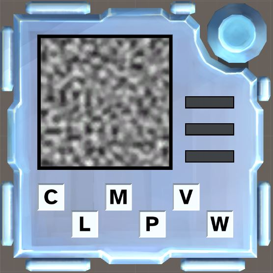

# KTANE Mods Behind-The-Scenes #1: Noise Identification

My very first mod, after consuming a lot of KTANE content through The Great Berate and joining the KTANE Discord.\
I never could've imagined what was coming afterwards ^^

I didn't know the "Identification" was already a saturated genre of modules, but luckily that made me avoid all of its pitfalls!

This probably was inspired by modules where you need to describe stuff to your expert, but voluntarily made with soloing in mind.

The pictures are all 64x64 pixels because I was very scared of taking too much space on the Repo for my first module. Little did I know that most people don't even consider that factor when making modules!!\
It also made me focus on recognizable Noise types, as they had to be very obvious even while small.

All icons were made in Substance Designer, using a singular noise generator and sometimes adjusting the contrast until it was just right.\
Some other Noises were considered, like the Cells category, or the Fur noise, or the Plasma noise; but their initials are already taken by other Noises that are more recognizable and interesting... So they were cut.

I remember being very proud of the layout of the module, the stage LEDs flickering for new stages, and of its image growing when appearing in-between the stage.\
Nowadays, I regard it as my worst-looking module and I'm thinking about redesigning it soon...

Why Noises? Probably because of the contrast with Listening, where you listen to noise and have to identify it. Also I wanted to open up Substance Designer, and having some references to Voronoi made me happy.\
You should've seen my reaction when I learned about Voronoi Maze!

Rule Seed was added waaaaaaaaay after the fact, and the idea of adding more Noises felt so compelling that I just did that, so there are four Noise Types that can only appear on Rule Seeds other than 1: Anisotropic, Dirt, Fluid and Gaussian.\
This is still not a lot, just 10 Noises in total, so it's one of those very rare modules that are affected by Rule Seed but that are still a Solo, and I'm very proud of that.