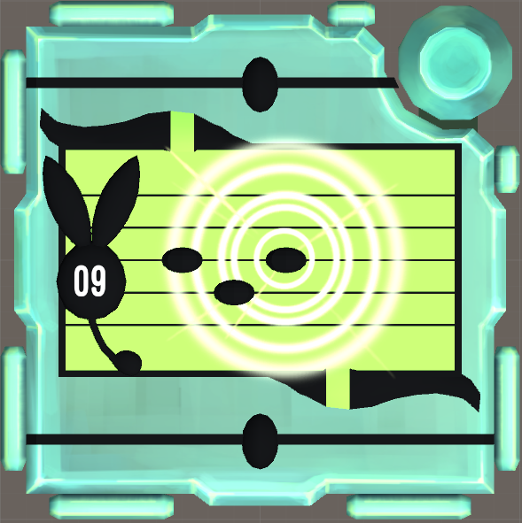
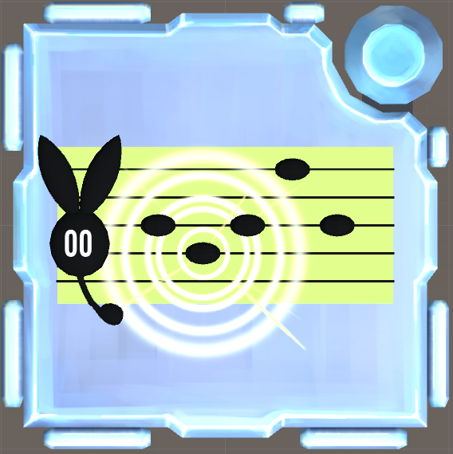

# KTANE Mods Behind-The-Scenes #4: Relic Song

Relic Song is my first Boss Module, and one of the mods with the most straight-forward history:\
I had the initial gameplay, and it didn't change during production, and its current gameplay is still the same.

It is based on the Pokémon Meloetta, one that I like a lot on account of how music-themed she is, and the dynamic form-changing aspect while in battle is very cool.

I designed this module to include both of Meloetta's forms in a form-changing dynamic that was integral to the central gameplay loop. I also wanted to do something that visually took some elements of her design: using her stave-hair and clef-hairclip as a focus upon which notes appear.\
Both Aria (green) and Pirouette (orange) forms appear and compete with each other right until the final submission.

I prefer bosses with low upkeep, like Forget Me Not, Whiteout or Übermodule, where you just get a read and do something very simple with it. No need for minute-long calculations or quests, just something you do on the side every time you get a stage.

I had very little experience with Boss Modules at the time, so the 1.0 release of this module didn't read you back stages if you strike (something that most bosses do) and it skipped stages if two mods solved in quick succession (which is a pretty bad idea).

I wanted this boss to also include a Stage Counter, so the number on the Clef indicates how many modules have been solved on the bomb, which is just a nice bit of utility bundled with the mod.

On the Audio & Visuals side, I designed the note apparition VFX to look like the move Relic Song's appearance in Pokémon Mystery Dungeon (see below). Just like UFO Satellites, the module turns Shiny after being Solved, with the stave turning a bright teal. I retrieved from the net the in-game 3D model for Meloetta and extracted just the clef for the module. A bunch of tweaks to its overall proportions and shape was needed to make it fit, but that's worth it!

The note apparition and solve sounds both are Meloetta's cry, but pitched up/down for all notes so they can be recognized just from the sound. Fun Fact, they're all pitched to the notes of E, F#, G#, A# and B, in B major, to fit the original cry!

Relic Song was my first (and probably not last) module to have received a visual update post-release! This is what Relic Song looked like initially:

I made the module more interesting than simply "rectangle on default casing", adding some more elements and 3D stuff to make it smoother and more interesting visually. It's supposed to be a Boss Module, make it look like an important module!!\
It also needed some improvements on the animations, it was missing a lot of smoothness and there were many bugs that looked like the module lagging, so a big cleaning was needed to give the module a new shine.