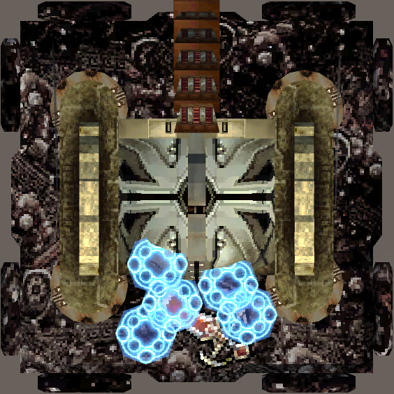
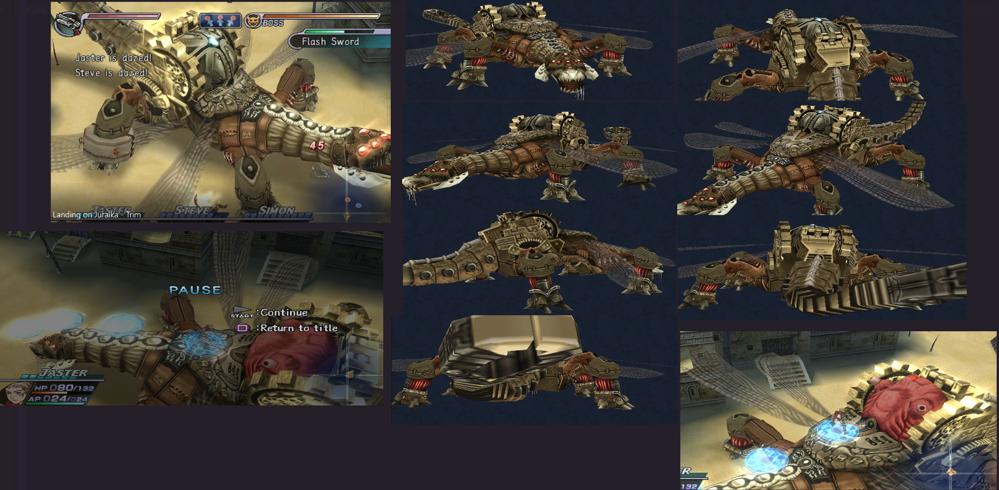
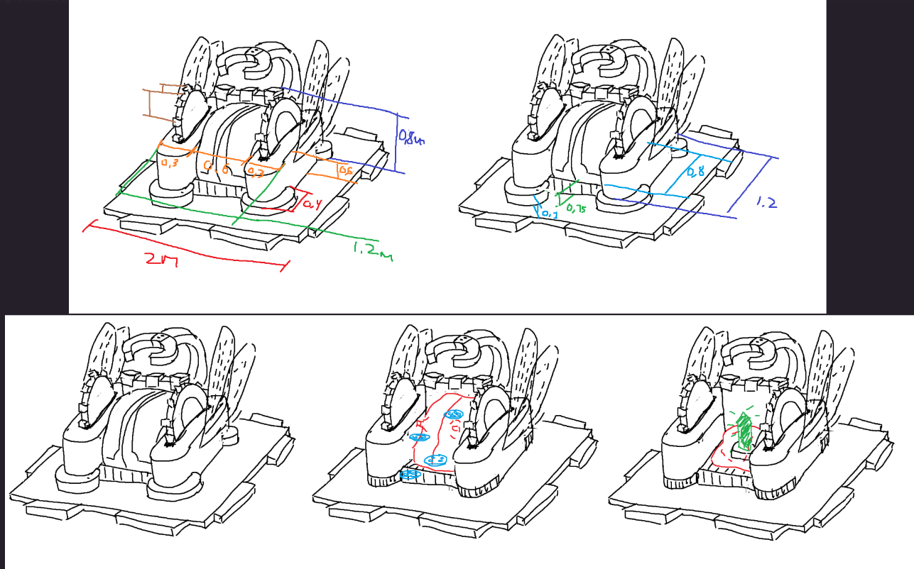

# KTANE Mods Behind-The-Scenes #6: Scorching Alchemist

One of my favorite games of all time is Rogue Galaxy, a completely unknown and forgotten JRPG released on the Playstation 2 in 2007. The "Scorching Alchemist", also known as a Mark VIII Salamander, is the first boss you fight at the end of the tutorial of the game.

Since all of my previous mods were Pokémon themed, and I was deep in the production of the Mythical Plates which also were Pokémon-Themed, I wanted to do something special for April 1st, so my idea was "for April First I'm making a module that's not Pokémon Themed, that's my prank".\
Nowadays I just do whatever I like and that's all good :D

Everything in this module has been hand-modelled, UV'd and then textured. I extracted textures from the game, but they were unusable as-is so they were HEAVILY modified to work. Compressing the long Salamander into a square footprint for the module required a bit of work, so I made a bunch of sketches to figure out what I wanted to do.

I knew I wanted something heavily mechanical, busy, with lots of moving parts, like Number Cipher or The Cube; so I looked for as many important elements to implement as possible, while still keeping something that was readable and pretty:
- The cage on the back imprisonning the heart was obviously brought back since that's the boss' weak point, even if redesigned
- The blue monography platforms that arrive for colour contrast
- The giant wings were folded back but still given movement to be interesting
- The giant cogwheels were kept even if moved
- The four shackles on the creature's legs are the first step in killing it in-game, so they were brought back too
- The giant claw tail obviously was brought back, though redesigned

I wanted to showcase the huge amount of sword available in the game, because I think a lot of them have very cool designs. However, every single picture of them I found on the net were blurry messes from phone-taken photos of screens... So I extracted the actual sprites from the game and used those! That's why there's a flavour text talking about "the only HD upload of those sprites on the entire Internet".

There is a non-zero possibility of another Rogue Galaxy module in the future. I have ideas, but let's not get too ahead of ourselves...!