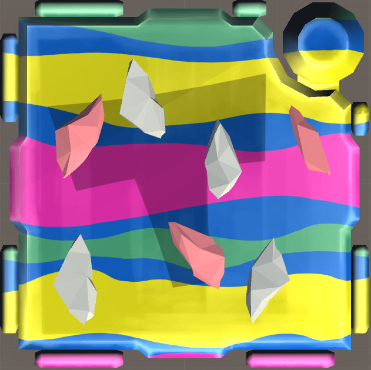
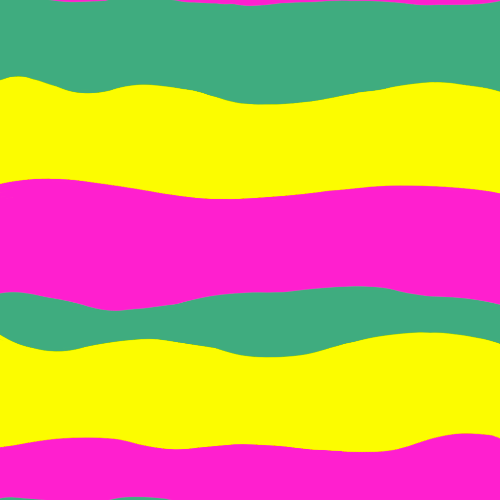
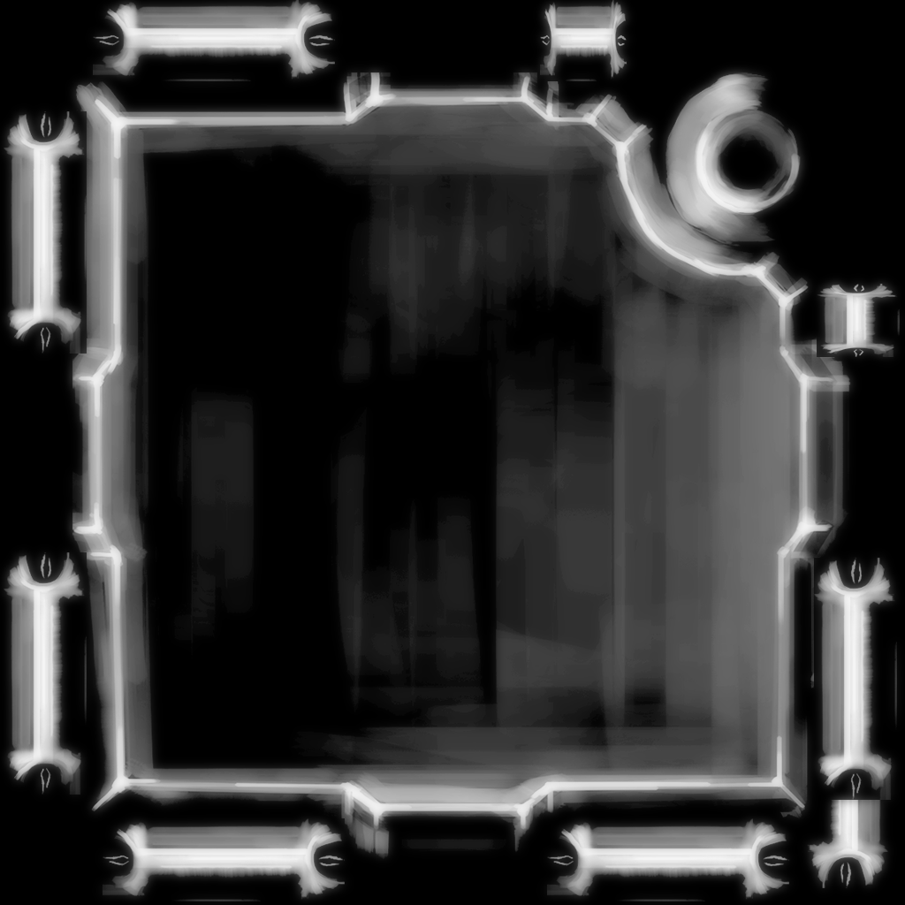

# KTANE Mods Behind-The-Scenes #5: Toxic Crystals

Toxic Crystals is a module based on the Pokémon Alolan Muk, and takes inspiration from multiple aspects of it to derive its sound, aesthetics and gameplay.

This module is one of my heaviest visual work to date, entirely due to the shader in the background! There are three textures at work: the Blue lines, the panning Green-Magenta-Yellow background, and a highlight texture to bring back the hand-paintedness of the regular module casing. People might not notice the highlights, but they're here and the module would NOT look good without them!

All 7 crystals use the same 3D mesh, it's just modeled to look different from all different directions, and then rotated in ways to make it look unique. This is how Rocks work in videogames in general; there are very few different rocks, it's all just rotation and placement!

Initially, the Highlighted Crystals were supposed to have a glow/aura around them, still visible in the module's SVG, but the module was already very heavy on the visuals so I opted against it!

The font on the module is "Memoir Square", a font specifically chosen because it looks like Splatoon. I don't remember why I chose Splatoon, but it just feels right.

A few numbers in the default manuals are references to Alolan Muk in a way or another:
- 089 (first Key conditions) is its Pokédex Number
- 520 (second Key condition) is its weight in Kg (removing the .)
- 216 (third Key condition) is for 2016, release date of Pokémon SM
- 038 (final Key condition) is because it evolves from Grimer at level 38

The module's shader sliding down is an exact recreation of its appearance in-game, and is the inspiration behind the "shift down cells" part of the module!

Talking about Gameplay, I wanted this module to absorb some part of solved modules over time, to emulate Alolan Muk's "Power of Alchemy" Ability which absorbs the Ability of an ally Pokémon that faints.\
I ended up with this "takes the first letter of the solved module" approach which makes planning ahead possible (partly, as Crystals still update). It starts with a T because this module's name is Toxic Crystals. This makes it one of the non-Boss non-Solve Dependant modules that still gets impacted by solves in its gameplay; which I think is fun!!

The conditions for the Keys also are semi-references to the module! There is a multiplication check for 38 (level of evolution), there is a check for more Unlits than Lits since it's a Dark Type, and there is a Parallel Port check since it's a parallel/regional form of regular Muk!