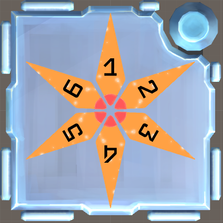
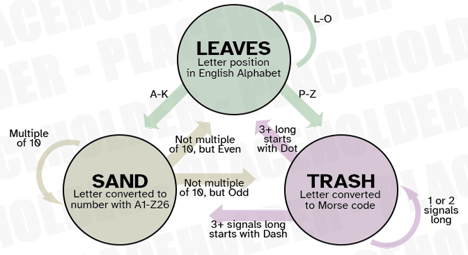

# KTANE Mods Behind-The-Scenes #2: UFO Satellites

Second mod, and I immediately wanted to up the stakes:
- Inspiration from Pokémon, specifically Iron Moth, because I thought we needed more Pokémon-based modules (while still being subtle).
- Custom visuals, including custom meshes, hand-painted textures, more complex animations, and a custom shader for the "plasma bubble" effect to be as close to the original reference as possible.
- Custom Sound Effects, using filters and LFO to try and get closer to that "warped futuristic" feeling that Iron Moth's cry has.
- Custom SVG Diagram inside of the module for the submission, with KTANE being the first time I worked with SVGs at all.
- Thinking about Souvenir from the very start of the concept, baked into the "puzzle" generation algorithm.

The "concatenate the indicators and count into that" idea was completely separated from UFO Satellites. I remember Blananas2 telling me "nope I don't remember a mod that does that in this exact shape" and immediately I knew this module had to exist, that was a call to action!

It was also potentially inspired by Indentation, in the way that there's a pattern to press that doesn't have a real "orientation" and so any answer that makes that shape is correct (regarding Indentation's first case in the table). I'm also pretty sure I got inspired by Simon Sends for the aspect of counting through a string and looping at the end.

Since this module is based on the Pokémon Iron Moth, the second shape has the letters HIMNORT as a condition, which are the letters IRON MOTH put alphabetically!\
Also, it's the reason why the checked port is the Parallel Port, since it's a Parallel (Paradox) Pokémon. This is an idea that will come up later (Toxic Crystals, Spooky Plate...).

This is also the module where I started the "This Module turns into the Shiny colour of the Pokémon post-solve" trope, which isn't present on all of them but which I very much like.

There is a backstory behind those Pokémon Modules, so I'm gonna tell it in this file:

Initially, they all were supposed to be one giant Module series, the "Capsules" series. They were Pokémon-inspired modules starting as a "capsule" (just a Pokéball) that took up the entire module casing, with both halves of the circle being coloured depending on the types of the Pokémon the module was based on.\
Upon pressing the capsule, it would open and the module would reveal itself.

This was completely unnecessary.

Like, it doesn't add anything to the mods beside make them a more obvious reference to Pokémon, and waste some time. Sure, it was a bit interesting to have half-a-dozen Pokéballs on the bomb and using the colours to determine which module would pop out... But you could just click it to see...

After talking about it with Blan, he convinced me that it was a bad idea, that series were hard to do correctly, and that they had to act similarly, with some common theming and visuals to make it worth it.\
Foreshadowing is a narrative devic-

UFO Satellites was the Satellites Capsule, but there were three other mods that probably will never see the light of day!

- Cloak Capsule, renamed Bagworm Cloak, was a module based on Burmy, one of my favorite Bug Pokémon. It was based on having piles of leaves, sand and trash on the module, some even having pebbles mixed within (Overcloaked piles). Using the count of each category, you'd create a key using a season (WINTER / SPRING / AUTUMN / SUMMER) which is amazing since all four seasons have exactly 6 letters, modifying the key, and then use this key as a way to switch between Leaves/Sand/Trash in a circular diagram (see below) to determine what to submit. Its main problem is that there's a bunch of nothing interesting going on; I like the idea of having the piles as a read, and I like the fact that all four seasons have 6 letters; but it's not enough to warrant the module's existence.

- Fillet Capsule was a module based on Veluza, one of my favorite Pokémon from generation 9. It was basically just an edgework-math module, an attempt at making a read-less module where you computed a few numbers and pressed the correct fish fillets in order. This became Toxic Crystals later down the line, just in a better way.
- Crescent Capsule was a module based on Lunala. It was my attempt at making some interactive module, but it was just a table with increasingly annoying functions. Imagine Fast Math, but each stage had its own formula depending on the given colour, and there was no time limit. Just pure, unfiltered mathslop.